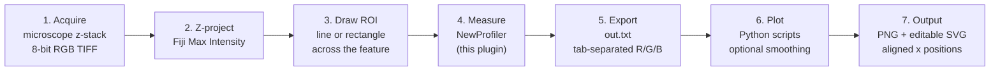

# NewProfiler

An ImageJ/Fiji plugin that measures **red/green/blue intensity profiles** along a line or rectangular selection in an RGB image, with two fixes over the original *Color Profiler*: scriptable, dialog-free text export and an x-axis that rescales to the selection length.

NewProfiler is a fork of **Color Profiler** by Dimiter Prodanov (University of Leiden, 2005), originally distributed as `Color_Profiler.jar`. The fork is licensed under the **GNU Lesser General Public License v2.1 or later**; the original author's copyright and license notices are preserved in every source file (see [Attribution](#attribution--license)).

> **Why a separate plugin?** ImageJ/Fiji loads every plugin JAR into one shared classpath. A modified class with the same name as the original silently loses to whichever JAR is loaded first, so "installing the fix" can appear to do nothing. All four NewProfiler classes carry an `NP_` prefix, so it coexists with the stock *Color Profiler* with zero class-name overlap.

---

## What was fixed

| # | Original behavior | NewProfiler behavior |
|---|-------------------|----------------------|
| 1 | Text export only through the native AWT *"Save as Text..."* dialog; a macro cannot choose the output path. | `run("New Profiler", "save=/abs/path/out.txt")` writes the file directly, no dialog. In batch mode, where `getWindow()` is null, the mouse listeners are registered only if a window exists. |
| 2 | The intensity graph pinned its x-axis to the ROI's **absolute pixel offset** (`offset … offset+n-1`). Resizing or moving a line did not rescale the axis. | The x coordinate is the **sample index** `i` (physical distance `i × pixelSize` for calibrated images). The axis always spans the full selection and rescales automatically. |

A compatibility guarantee matters more than either fix: macro export is **pinned to the legacy text layout** regardless of Fiji's global *"Do Not Save X-Values"* setting, so the output stays byte-compatible with downstream analysis scripts. The manual *"Save..."* button keeps its original, settings-dependent behavior.

---

## Where this plugin sits in the workflow

NewProfiler is one step in a fluorescence image-analysis pipeline. It is the bridge between a **Fiji measurement** and a **programmable plot**: it turns an RGB intensity profile into a plain-text file that a script can consume. Understanding the whole chain explains why the export format and the x-axis semantics are what they are.



### Step by step

1. **Acquire.** Images are typically acquired as z-stacks and exported as 8-bit RGB TIFFs with LUT rendering. The meaning of each color channel depends on the experiment; the plugin simply measures the R/G/B values present in the image. These are rendered LUT images, not raw linear intensities.
2. **Z-project.** In Fiji, collapse the stack with `Z Project… → Max Intensity` to a single 2D plane so the signal through the depth of the stack is represented in one image.
3. **Draw the ROI.** On the projected image, draw a line (or rectangle) across the feature to be profiled. Any channel with a clear edge can later serve as a positional reference for aligning profiles between images.
4. **Measure.** Run NewProfiler (interactively or from a macro). It samples the R/G/B value at every pixel along the selection and also prints per-channel statistics (mean, standard deviation, 5th/95th percentile, channel ratios) to the Results table.
5. **Export.** The macro's `save=` argument writes one text file per ROI. Each line is a tab-separated RGB triplet; the file has no header.
6. **Plot.** Downstream scripts read these files:
   - a single-ROI script produces one plot per measurement (optionally with a denoised overlay);
   - a multi-ROI script averages several measurements into one curve (optionally with faint individual curves).

   Both can locate a reference edge from one channel, optionally align profiles to a common origin, and by default plot **raw intensity** on the y-axis. Gaussian smoothing is available. Output is PNG plus an SVG whose text remains editable (`svg.fonttype="none"`).
7. **Interpret.** Use the profile to compare how signal is distributed along the selection. Absolute intensity generally should not be compared across images acquired with different gain or LUT settings. Keeping raw counts on the y-axis preserves the true relative amplitude between channels; normalizing each channel to its own peak would inflate weak channels and erase those differences.

### Output file format

One row per sample, three columns, leading tab, three decimal places, no header:

```
	255.000	0.000	0.000
	247.000	3.000	0.000
	...
```

The leading empty field and fixed three-column layout are deliberate: the downstream parsers skip the first field and read columns as R, G, B. Changing this layout (for example by letting Fiji prepend x-values) will break those scripts.

### What the x-axis means

- **Line selection** (including polyline/freehand): x is the sample index, `0 … n-1`; for a calibrated image it is physical distance, `i × pixelSize`. This is the behavior the x-axis fix restores.
- **Rectangular selection**: the default *"Vertical Profile"* option averages **across columns** (x = column position across the rectangle's width); the thin dimension is averaged out. Holding `Alt` (or disabling *"Vertical Profile"*) averages **across rows** instead (x = row position down the rectangle's height). A rectangle of width `W` therefore yields `W` x-positions; the small thickness is the dimension being averaged, not an x offset.

---

## Installation

Copy `NewProfiler.jar` into Fiji's `plugins` directory (typically `Fiji.app/plugins/`) and restart Fiji.

You will get a new **`Analyze > Tools > New Profiler`** entry, alongside (not replacing) the original *Color Profiler*. To confirm the right JAR loaded, open **`Help > About Plugins > New Profiler...`** — it should show an *"About New Profiler..."* dialog. If you only see *"Color Profiler..."*, Fiji was not restarted or the JAR is in the wrong folder.

> If you previously installed a first build of this fork, overwrite the old `NewProfiler.jar` with the current one and restart — the earlier build still used class names that collided with the original plugin.

---

## Usage

### Interactive

Open an RGB image, draw a line or rectangular selection, then run `Analyze > Tools > New Profiler`. A plot window appears with red, green and blue curves; use its *List*, *Save...* and *Copy...* buttons as in the original plugin. Moving or resizing the ROI updates the plot.

### Batch / macro (the new capability)

```ijm
setBatchMode(true);
open("/path/to/projected_image.tif");          // z-projected image
makeLine(x1, y1, x2, y2);                       // a ROI is required
run("New Profiler", "save=/path/to/measurements/out.txt");
setBatchMode(false);
```

- `save=` takes an absolute path. If the path contains spaces, wrap it in brackets: `save=[/path with spaces/out.txt]`.
- One `run` call writes one file; the argument is one-shot and never reused for a later ROI.
- No dialog is shown. The plot window and Results table behave exactly as in interactive mode (and are suppressed by `setBatchMode(true)`).

### Building from source

`src/` is the unpacked original source, kept for reference. `src_np/` is the build source: `rename_classes.py` reads `src/`, renames the four classes with an `NP_` prefix (longest-first, word-boundary regex to avoid partial matches), and writes `src_np/` — the original files are never modified. All fork-specific edits are marked `NewProfiler` in the source comments.

Compile with Fiji's bundled JDK against its ImageJ 1.x JAR:

```bash
JAVAC="/path/to/Fiji/java/<platform>/<jdk>/bin/javac"
IJ="/path/to/Fiji/jars/ij-*.jar"

"$JAVAC" -cp "$IJ" -d build_np src_np/*.java
cp src_np/plugins.config src_np/License.txt src_np/README.txt build_np/
(cd build_np && jar cf ../NewProfiler.jar .)
```

Point both variables at the JDK and the `ij-*.jar` bundled with your own Fiji installation. Under Git Bash on Windows, pass Windows-style paths (for example `C:/...` or `D:/...`) to `javac`; `/c/`-style paths are not accepted.

### Verification

`_verify/Verify.java` is a headless harness that calls the plugin API directly, bypassing the ImageJ macro engine (which throws `HeadlessException` in a pure headless JVM because it cannot initialize AWT menus). It builds a synthetic RGB image with a red band starting at x = 20, applies `save=`, and checks that:

- the path is parsed and the file is written (44 rows);
- the x-axis is `0 … 43` (index-based, not pinned to offset 20 as in the original);
- the first data row is `\t255.000\t0.000\t0.000`, structurally identical to the original plugin's output;
- the four classes have zero name overlap with the original JAR.

ImageJ 1.x `run()` commands require a GUI (they initialize menus); use the API harness for automated checks, or run macros inside a Fiji GUI session.

---

## Known limitations

- The plugin measures **rendered 8-bit RGB (LUT) images**. It does not read raw 16-bit linear data, and per-image gain/LUT differences mean absolute values are not comparable across images.
- Headless macro execution is an ImageJ 1.x limitation, not a NewProfiler bug; see [Verification](#verification).
- The x-axis fix uses the sample index for uncalibrated images and `index × pixelSize` for calibrated ones; it does not integrate over a curved path with varying calibration.

---

## Repository layout

| Path | Contents |
|------|----------|
| `NewProfiler.jar` | Ready-to-install plugin (four `NP_` classes + `plugins.config` + license + readme) |
| `src_np/` | **Build source** — renamed, isolated classes |
| `src/` | Original unpacked source (reference only; class names collide with stock plugin) |
| `rename_classes.py` | Generates `src_np/` from `src/` |
| `build_np/` | Compiler output |
| `_verify/` | Headless verification harness, macros and recorded output |
| `LICENSE` | GNU LGPL v2.1 text |
| `README.md` | This file |

---

## Attribution & license

NewProfiler is derived from **Color Profiler** (version 1.2, 12 June 2005) by **Dimiter Prodanov**, University of Leiden (contact: `D.Prodanov at lumc.nl`). Original plugin page: <https://imagej.net/plugins/color-profiler.html>. The original source was obtained by unpacking the official `Color_Profiler.jar`, as documented on that page.

Original work licensed under the GNU Lesser General Public License, version 2.1 or later. This fork keeps the same license and all original copyright notices. See `LICENSE`.

```
Color Profiler
Copyright (C) 2005 Dimiter Prodanov, University of Leiden

This library is free software; you can redistribute it and/or modify it under
the terms of the GNU Lesser General Public License as published by the Free
Software Foundation; either version 2.1 of the License, or (at your option)
any later version.
```
